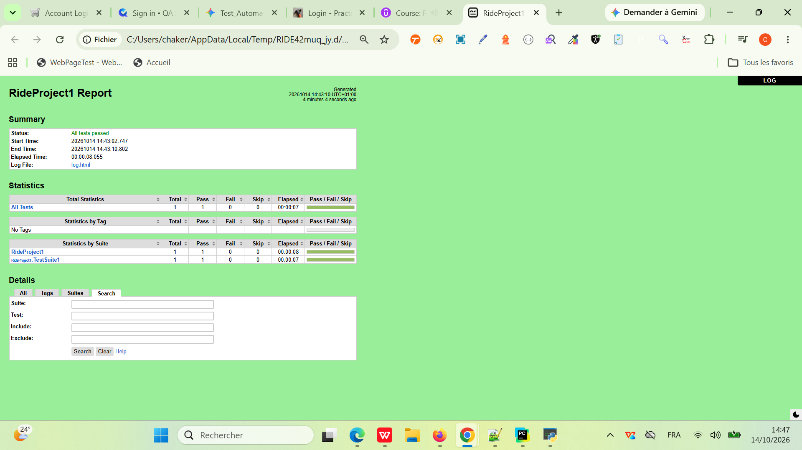
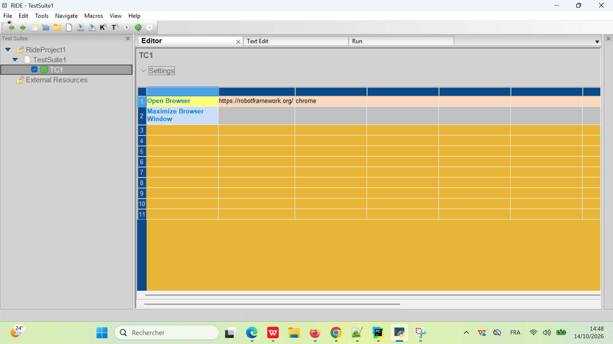
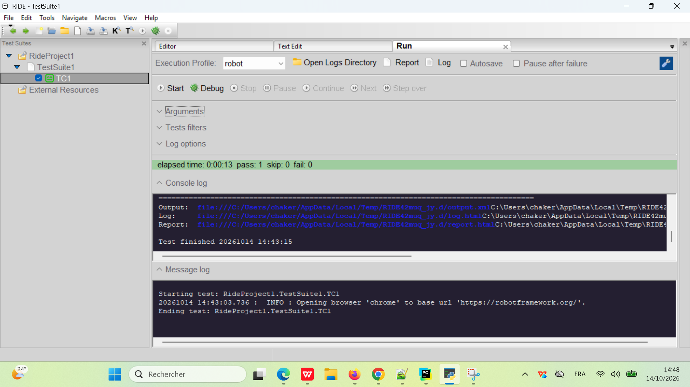
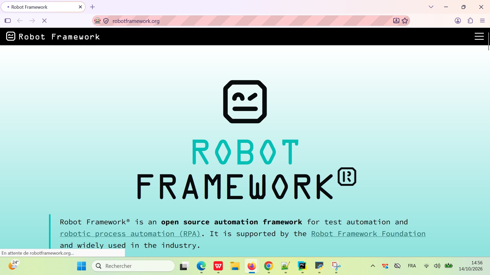
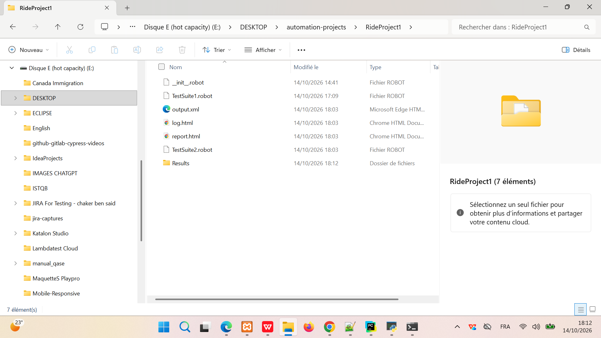
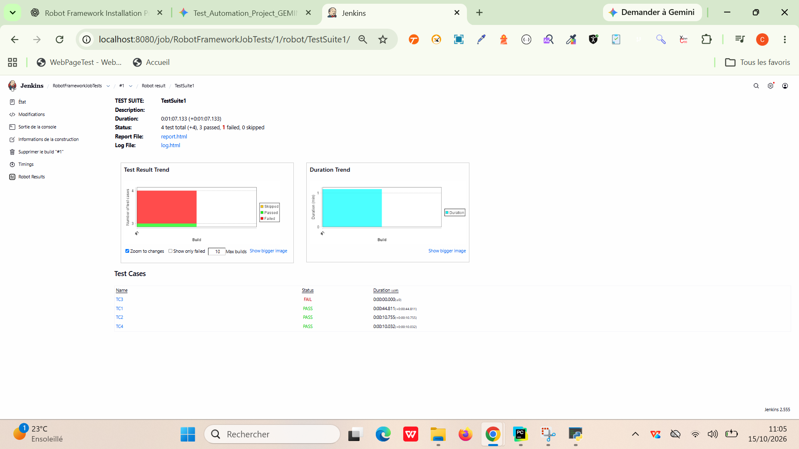
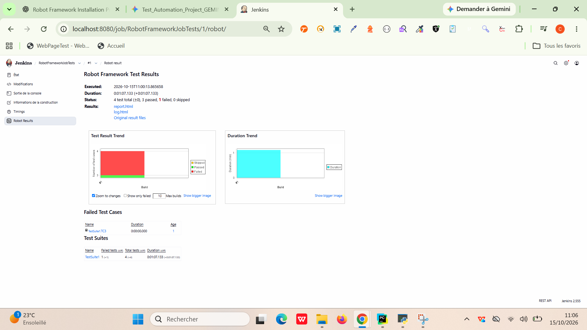
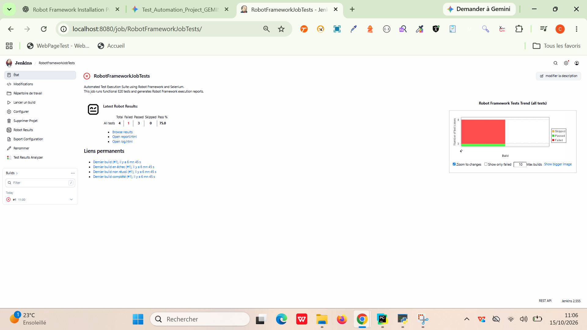
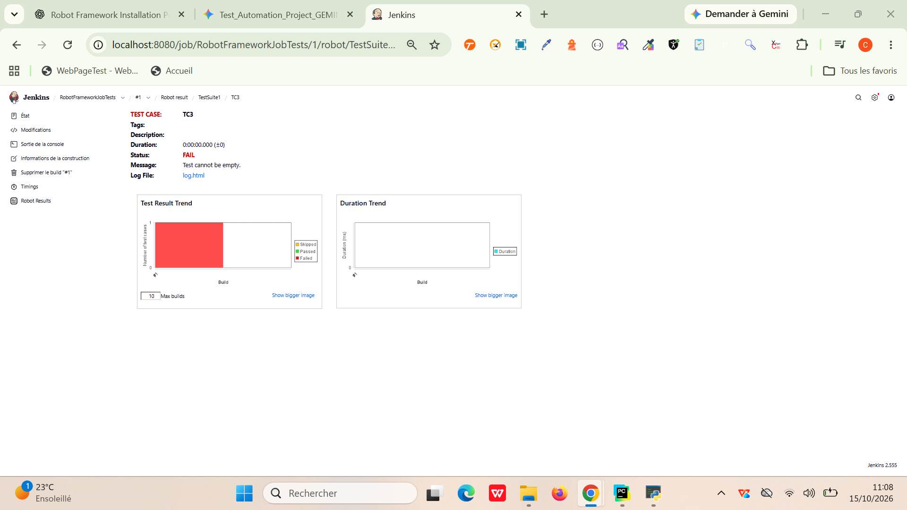

Today we will learn:
====================
1. How to setup Robot Framework from scratch
2. How to uninstall Robot framework
3. Helpful Tips
==========================================

How to setup Robot frameWork
----------------------------

Step 1: Pre-Check
            Check if python is already installed
                     python --version
                     pip --version
            Check if robot framework is already installed
                     robot --version (e.g. Robot Framework 7.5 (Python 3.12.0 on win32))

Step 3: Set Python in environment variables
          C:\Python27;C:\Python27\Scripts;
          Check:     python --version
                     pip --version
         
Step 4: Install robot framework
        pip install robotframework
        to uninstall: pip uninstall robotframework

Step 5: Check on cmd:
                   robot --version
                   pybot --version

Step 6: Download and install wxPython
        https://sourceforge.net/projects/wxpython/files/wxPython/3.0.2.0/wxPython3.0-win32-3.0.2.0-py27.exe/download
        check with > pip freeze
        wxpython should be available

Step 7: Install 
       pip install robotframework-ride
       https://github.com/robotframework/RIDE/wiki/Installation-Instructions

Step 8: On cmd goto folder where ride.py is (C:\Users\chaker\AppData\Local\Programs\Python\Python312\Scripts)
        run on cmd PowerShell:  .\.venv\Scripts\ride
        This should open RIDE

========================================================================================================================
How to uninstall Robot Framework
--------------------------------

pip uninstall robotframework-ride
pip uninstall robotframework

========================================================================================================================
Helpful Tips:
1. Always install wxPython before installing RIDE.
   wxPython is a wrapper for getting the GUI of RIDE.
   So it is important to install wxPython before you install RIDE.

2. Always check your python version and install wxPython for the same version ***32 bit - check your python 
   ver by running command python and install same bit wxPython.

3. pip cache folder is located at - C:\Users\chaker\AppData\Local\pip\cache
If you uninstall a lib and install it again, it will use the zip from cache.
to install fresh
   - you can empty contents of cache folder
   - pip install --no-cache-dir robotframework-ride

4. Versions prior to Robot Framework 3.0 did not have the robot script. Instead, they
   had pybot, jybot and ipybot scripts that executed tests using Python, Jython and IronPython, respectively. 
   These scripts are still installed, but the plan is to deprecate and remove them in the future.

5. Robot Framework UserGuide -
   http://robotframework.org/robotframework/latest/RobotFrameworkUserGuide.html
   https://github.com/robotframework/QuickStartGuide/blob/master/QuickStart.rst

   Keyboard Shortcuts -
   https://github.com/robotframework/RIDE/wiki/Keyboard-Shortcuts

   RF GitHub page -
   https://github.com/robotframework

========================================================================================================================
RobotFramework with RIDE

Some limitations of using RIDE:
- robotframework-ride doesn't work on Python3
- RIDE needs wxPython (a specific ver) which is not compatible on macOS

========================================================================================================================
How to create first Selenium test in RIDE: so RIDE IS A GUI editor for writing Framework Tests.

Today we will learn:
1. How to create a project RIDE
2. How to import selenium library
3. How to add browser drivers
4. How to create first selenium test

Step 1: Open RIDE
        You can ride from cmd by command: .\.venv\Scripts\ride OR python -m robotide
        You can also create a desktop shortcut

Step 2: RIDE - Very Simple UI

Step 3: Create New Project > Test Suite > TestCase
How do you create your first Selenium test in Robot Framework using RIDE?
Create a test suite -> Add test case -> Use Selenium Keywords.

Step 4: Download and add SeleniumLibrary
        Goto - http://robotframework.org/ > Resources > LIBRARIES > External >SeleniumLibrary
        ===> It is  library used for browser automation.

Step 5: In Project
        Add Import > Library > SeleniumLibrary
        If it shows in Black that means its successfully imported else not (in red)

Step 6: Now in the TC if you start typing Selenium and ctrl+space it will show you all the keywords of Selenium2Library.
        You can use full name - SeleniumLibray.Open Browser
        OR
        only action - OpenBrowser

Step 7: Add keywords and run 

Step 8: Add browser drivers

========================================================================================================================
How to run test on multiple browsers - Chrome, Firefox, Edge, IE

Today we will learn:
1. How to add browser exe files
2. How to run test on different browsers.

Step 1: Open RIDE
Step 2: Create a step to open browser in Firefox
        This will fail if you do not have firefox driver exe (gecko driver exe) 
        in python folder
Step 3: Get browser Driver exe file. Go to SeleniumHQ.org and Download browser driver exe file.
Step 4: Keep the driver exe file in \Python312 Scripts folder
        Note: This folder should be added in environment path variable (You can use any other location inside
              Python folder as well.)
Step 5: Open RIDE > Goto Test Case > In the test step open browser and give the browser name.

BROWSER           |        NAME TO USE
Firefox           |    firefox, ff
Google Chrome     |    googlechrome, chrome, gc
Internet Explorer |    internetexplorer, ie
Edge              |    edge

Step 6: Run and Validate

========================================================================================================================
How to use Variables ?

Today we will learn:
--------------------
1. What are variables in Robot Framework
2. Types of variables
3. How to create variables
4. How to refer variables

Useful TIPS
-------------------------------------------------------------------------------------
What are variables ?
Variables are elements used to store values that can be referenced by other elements.
RobotFramework has 3 types of variables:
SCALAR; LIST; DICTIONARY

Step 1: Open RIDE
Step 2: Create a Test Case for login
        http://localhost/orangehrm/web/index.php/dashboard/index
Step 3: Create a SCALAR variable for url and refer in TestCase
        syntax: ${VariableName}
Step 4: Create a LIST variable for username and password and refer in TestCase
        syntax: $VariableName} for example: ${CREDENTIALS}[0], ${CREDENTIALS}[1]
Step 5: Create a DICTIONARY variable for username and password and refer in TestCase
        syntax: &{VariableName}

Environment:
%{VariableName} For example:%{username} run this test on Windows %{os}.

Useful TIPS:
===========
1. If a non-existent variable is used in test-data, the keyword using it will fail.
2. We can set variables from command line.
3. Variables are case-insensitive
4. As best practice use uppercase variable names for global variables
   And lowercase variable names for local variables.

  Built-In Variables: https://robotframework.org/robotframework/latest/RobotFrameworkUserGuide.html#built-in-variables

========================================================================================================================
Today we will learn:
-------------------
1. What are Keywords
2. Types of Keywords
3. How to create User Keywords
4. How to reference User Keywords

Useful TIPS:
Robot framework has 2 types of Keywords:
LIBRARY KEYWORDS: low level keywords
USER KEYWORDS: high level keywords

custom Keywords
combination of library keywords/actions

Step 1: Open RIDE
Step 2: Create New User Keyword (TestSuite > RightClick > Choose New User Keyword) GIVE Name and Arguments.
Step 3: Create a Keyword for login
Step 4: Refer the keyword in TestCase

========================================================================================================================
How to Use SETUP and TEARDOWN:

Today we will learn:
1. What is Setup and TearDown
2. How to use

SETUP - Keyword executed before running any lower level component/Keyword.
TEARDOWN-Keyword executed after running any lower level component/Keyword.

Step 1: Open RIDE
Step 2: Create Test Suite Setup and Teardown and run it.

========================================================================================================================
How to use TAGS:

Today we will learn:
-------------------
1. How to create TAGS
2. How to use tags during Test Execution
3. How to use tags in Reports
4. How to create Dynamic Tags
5. How to set Tags from command line.

Tags are used to classify/categorize test cases.

Useful TIPS
command line option: --settag
Step 1: Goto cmd and cd to your robot framework project
Step 2: syntax
        robot -t TC4 TestSuite.robot
        robot -t Test4 --settag=Regression TestSuite.robot

========================================================================================================================
How to run Test from Command line:

Today we will learn:
-------------------
1. How to run one specific test
2. How to run selected tests
3. How to run tests with TAGS
4. How to run all Tests in a Suite
5. How to send RESULTS to a specific folder

Useful TIPS:
Step 1: Open cmd and goto the location of project
Step 2: Run single test
        robot -t TestName SuiteName.robot
Step 3: Run multiple Tests
        robot -t Test4 -t Test5 SuiteName.robot
Step 4: Run Tests With Tags
        robot --include tagName SuiteName.robot
     e.g; robot--include TestSmoke TestSuite2.robot
Step 5: Run Tests With Multiple Tags
        robot -i Sanity -i Smoke TestSuite.robot
Step 6: Run all tests in a test suite
        robot TestSuite2.robot
Step 7: Send Results to a folder
        robot -t TestCase1 -d Results TestSuite2.robot

Useful TIPS:
Using Regular Expressions: robot -e S* TestSuite2.robot
How to make tags critical / non-critical: robot -i S* --critical Smoke TestSuite.robot 
                                          robot -i S* --n Smoke TestSuite.robot
Commands lines option guide.
https://github.com/robotframework/robotframework/blob/master/doc/userguide/src/Appendices/CommandLineOptions.rst

========================================================================================================================
How to run tests from JENKINS

Today we will learn:
-------------------
1. How to create jobs in jenkins
2. How to add robot framework plugin in jenkins
3. How to configurate robot framework tests in jenkins
4. Show html reports on jenkins
5. Run and Validate

Useful TIPS:
Step 1: Download Jenkins
Step 2: Start Jenkins
Step 3: Add robotframework plugin into Jenkins
Step 4: Create a job to run robotframework tests
Step 5: Show the Results of execution

