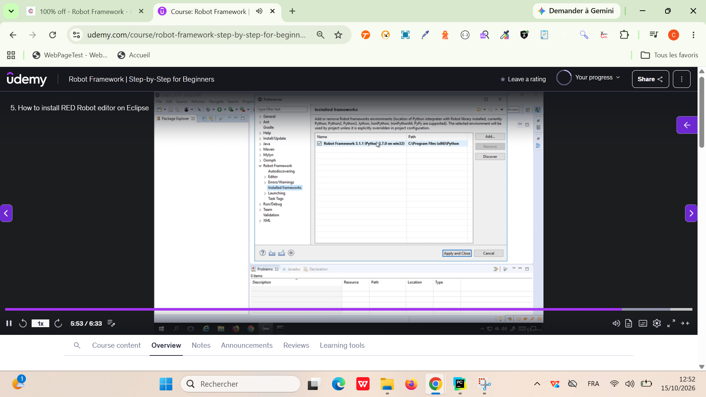

Robot Framework: is a python based test automation framework.
                 used keyword driven testing approach.

IDE for Robot Framework:
RIDE: very easy for tests
PyCharm
TextMate
Eclipse: RED - Robot Editor - plugin
(open eclipse)
(eclipse -> Marketplace)
(enter RED in searchbar)
(click on Install)
(Install & restart Eclipse)
(Open perspective -> show robot perspective)

RED requires python interpreter with robot framework installed on your system.

Tool can be used to install Python in MacOS easily:
Homebrew
Homebrew simplifies Python installation on mac0S.
brew install python This command installs the latest Python version.

=======================================================================================================================
How to create a new Robot Framework Project ?

Step 1: Eclipse > Windows > Perspective > Open > Perspective > Robot
Step 2: New > Robot Project
Step 3: Create new TestSuites